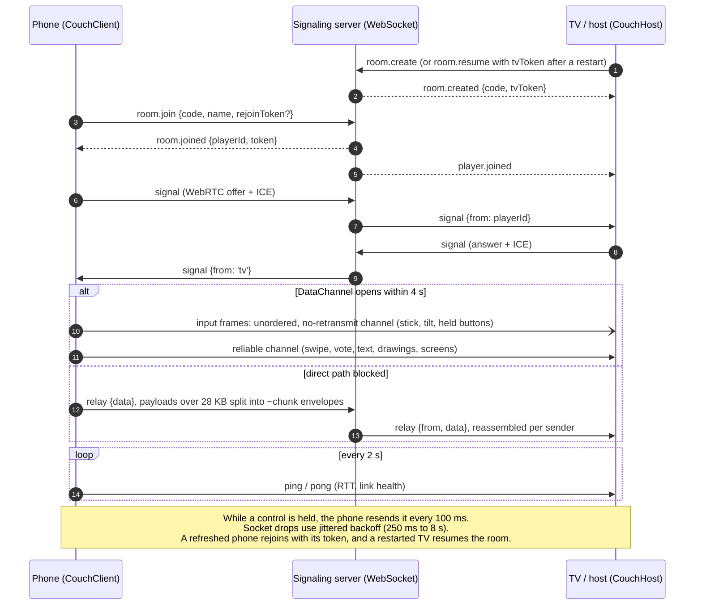

# couchpad

[](https://github.com/MaanavKrishna/couchpad/actions/workflows/ci.yml)
[](LICENSE)

**Turn every phone in the room into a game controller, with no app install.** Players scan a QR code and their phone becomes a gamepad: joystick, buttons, tilt, swipe, draw pad, vote, or text. Inputs stream to your TV or web game over a direct WebRTC DataChannel. When the direct path is blocked (strict Wi-Fi, client isolation), couchpad falls back to a WebSocket relay without the game noticing. Lost connections reconnect themselves, and a refreshed phone or a restarted TV gets its seat and room back. couchpad is a small TypeScript library with one runtime dependency, and it was extracted from the Fire TV party game [Cadabra](https://github.com/MaanavKrishna/cadabra).

## How it works



## Quick start

```ts
import { CouchHost, CouchClient, mountController, type ControlWidget } from 'couchpad';

// TV / big screen: make a room and show `code` as a QR to https://your-site/?room=CODE
const host = new CouchHost({ wsUrl: 'wss://your-server/ws', household: 'living-room' });
const { code } = await host.create();
host.on('player', (id: string) => host.sendTo(id, { t: 'screen', name: 'play', data: { widgets: [
  { kind: 'joystick', id: 'move' }, { kind: 'button', id: 'jump', label: 'JUMP' } ] } }));
host.on('input', (id: string, frame) => console.log(id, frame.axes, frame.buttons));

// Phone: join, then render whatever controls the host asks for
const client = new CouchClient({ wsUrl: 'wss://your-server/ws' });
client.onMessage((m) => {
  if (m.t === 'screen') mountController(document.body, (m.data as { widgets: ControlWidget[] }).widgets, (f) => client.sendInput(f));
});
await client.join(code, 'Maanav');            // client.mode is now 'direct' or 'relay'
```

A full runnable example (reference server, host page and phone page) is in [`examples/`](examples):

```bash
npm install
npm run example        # http://localhost:8787  (open /phone.html?room=CODE on a phone on the same Wi-Fi)
```

Serve the phone page over HTTPS so tilt, vibration and wake-lock work.

## Features

- **Direct first, and the relay always works.** WebRTC DataChannel peer to peer on the LAN when it opens within **4 s**. Otherwise it falls back to a WebSocket relay, and payloads over **28 KB** are chunked to fit **32 KB** API Gateway frames (partial chunks expire after **10 s**).
- **Two channels.** Continuous input (stick, tilt, held buttons) uses an unordered, no-retransmit channel throttled to **30 Hz**. One-shots (swipe, vote, text, drawings up to **200 KB**) and state use a reliable channel.
- **Built for flaky phones.** Reconnect with jittered backoff (**250 ms to 8 s**, ±30%). A rejoin token gives a refreshed phone its seat back, and a restarted TV app resumes its room. While a link is down, reliable messages wait in a queue (max **64**). A **2 s** ping tracks RTT, and a **2 s** grace period covers ICE blips.
- **Nothing sticks "pressed".** A held control is resent every **100 ms**, a button release is sent twice (**30 ms** apart), and a zeroing frame goes out on blur or hide.
- **Framework-free widgets.** `mountController()` turns a declarative widget list into touch controls with pointer capture, haptics and CSS-variable theming. It has 8 widget kinds.
- **Tiny and testable.** One runtime dependency (`zod`). WebSocket, RTCPeerConnection, clock and storage are all injectable, so **34 tests** run in Node without a browser.
- **Proven on a TV.** In Cadabra it carries input from up to 4 phones to a Fire TV Stick HD, measured at **13 to 16 ms** on a home network.

## Used by Cadabra

[**Cadabra**](https://github.com/MaanavKrishna/cadabra) is a Fire TV party game where the room invents the game and then plays it. Every phone joins by QR and becomes the controller through couchpad. Cadabra's production signaling runs on API Gateway WebSocket, Lambda and DynamoDB.

[](https://github.com/MaanavKrishna/cadabra)

## Install

Not yet published to npm. Use it from git or copy `src/`:

```bash
npm install github:MaanavKrishna/couchpad
```

It ships as TypeScript source (`main: src/index.ts`). Bundle it with Vite, esbuild or similar.

## API

### `CouchHost`

| Member | Description |
|---|---|
| `new CouchHost({ wsUrl, household, transport?, iceServers?, storage?, ... })` | `transport: 'relay-only'` skips WebRTC. Default ICE server is Google's public STUN; pass your own for production. |
| `create()` / `resume(code?)` | Create a room, or reclaim one after a restart (the TV token is kept in `sessionStorage`). Resolves `{ code }`. |
| `sendTo(playerId, msg)` / `broadcast(msg)` | Reliable send over the DataChannel, else relay (chunked), else queued (max 64). Returns `false` if undeliverable. |
| `players()` | `Map<id, { name, avatar, connected, transport: 'direct' \| 'relay', rttMs }>` |
| `on('player' \| 'left' \| 'input' \| 'msg' \| 'resumed' \| 'error', cb)` | `input` delivers validated `InputFrame`s, stale continuous frames are dropped. |
| `close()` | Tear everything down. |

### `CouchClient` (phone)

| Member | Description |
|---|---|
| `new CouchClient({ wsUrl, transport?, inputHz?, ... })` | Input is throttled to 30 Hz by default; held inputs are resent every 100 ms. |
| `join(code, name)` | Resolves `{ playerId }`. Rejoin tokens are stored per room code. Rejects with `room.notFound`, `room.full`, `join.timeout`, ... |
| `sendInput(frame)` | Continuous frames use the unreliable channel; frames with `swipe`/`vote`/`text`/`draw` are one-shots on the reliable path. |
| `send(msg)` / `onMessage(cb)` | Reliable app messages to and from the host. |
| `mode`, `rttMs()` | Current transport and measured round trip. |
| `on('mode' \| 'tv.left' \| 'tv.back' \| 'link' \| 'error', cb)` | Link status events. |

### Widgets

`mountController(el, widgets, onFrame, opts?)` returns an `unmount()` function. Widget kinds: `joystick`, `button`, `hold`, `tilt`, `swipe`, `draw` (outputs a small PNG/JPEG data URL), `vote`, `text`. Style them with CSS variables: `--cp-primary`, `--cp-accent`, `--cp-glow`, `--cp-text`, `--cp-surface`, `--cp-font`, `--cp-display-font`. Individual `createJoystick`, `createButton`, ... factories are exported too. Zod schemas for everything on the wire (`InputFrameSchema`, `ControlWidgetSchema`, `PeerMsgSchema`) are exported so a host can validate untrusted widget lists.

## Signaling protocol

couchpad does not ship a server; it expects a small WebSocket JSON protocol. Every message is a JSON object with a string `t`. The server must identify the host connection as `'tv'` and phones by a server-assigned `playerId`.

**Client to server**

| Message | From | Meaning |
|---|---|---|
| `{t:'room.create', household?}` | host | Make a room. |
| `{t:'room.resume', code, tvToken}` | host | Reclaim a room after reconnect. |
| `{t:'room.join', code, name, rejoinToken?}` | phone | Join, or take back a seat with the token. |
| `{t:'signal', to, data}` | both | WebRTC offer/answer/candidate. Phones always send `to:'tv'`; the host sends `to:<playerId>`. |
| `{t:'relay', to?, data}` | both | Fallback transport. Same addressing as `signal`. |
| `{t:'ping'}` | both | Keepalive; answer `{t:'pong'}`. |

**Server to client**

| Message | To | Meaning |
|---|---|---|
| `{t:'room.created', code, tvToken}` | host | `code` is 4 letters from `BCDFGHJKLMNPQRSTVWXZA`. |
| `{t:'room.resumed', players?:[{id,name,avatar?}]}` | host | The live player list is the truth after a resume. |
| `{t:'room.joined', playerId, token, name}` | phone | `token` is the rejoin token. |
| `{t:'player.joined', player}` / `{t:'player.left', playerId}` | host | Presence. |
| `{t:'tv.left'}` / `{t:'tv.back'}` | phones | Host presence; phones re-offer WebRTC on `tv.back`. |
| `{t:'signal' \| 'relay', from, data}` | either | `from` is `'tv'` or a `playerId`. Servers must set it, never trust the sender. |
| `{t:'error', code, message?}` | either | `room.notFound`, `room.full`, `room.badToken`, `room.targetGone`, `room.rateLimited`, ... |

Additional server messages (for example game-specific events) are ignored by couchpad, so you can multiplex your own on the same socket.

**Peer messages** (inside the DataChannel or inside `relay.data`): `{t:'input', frame}`, `{t:'screen', name, data?}`, `{t:'ping', id}`, `{t:'pong', id}`. An `InputFrame` is `{ t, axes?, buttons?, tilt?, swipe?, draw?, vote?, text? }`.

**Relay chunking.** API Gateway-style WebSocket frames cap near 32 KB, so relay payloads larger than 28 KB are split into `{t:'~chunk', id, seq, total, part}` envelopes and reassembled per sender (partials expire after 10 s). Your server just forwards `relay.data` as is.

[`examples/server/server.mjs`](examples/server/server.mjs) is a ~100 line reference implementation with `ws`. Cadabra's production version runs on API Gateway WebSocket, Lambda and DynamoDB.

## Development

```bash
npm install
npm test          # 34 tests: transport state machine, reconnects, chunking, widgets (jsdom), example server round trip
npm run typecheck
```

## Contributing and security

See [CONTRIBUTING.md](CONTRIBUTING.md) and [SECURITY.md](SECURITY.md).

## License

MIT, copyright 2026 Maanav Krishna. See [LICENSE](LICENSE).
